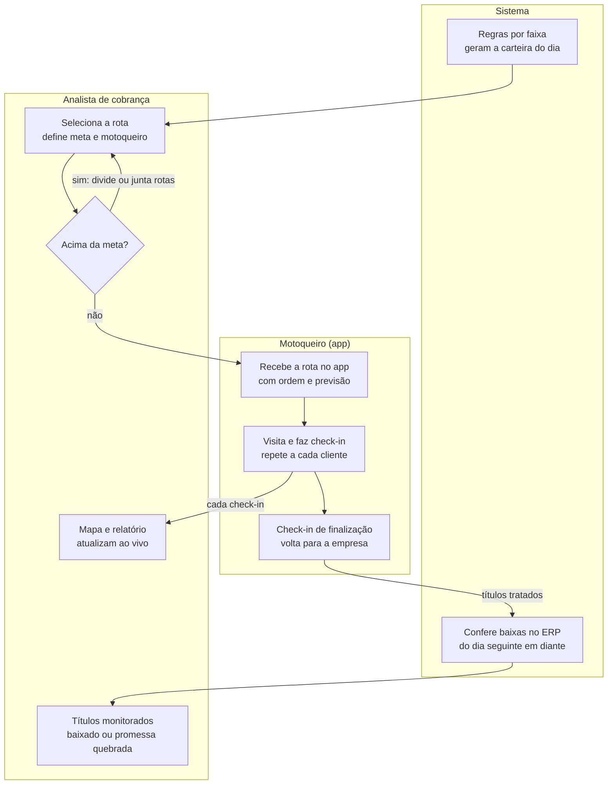

# Visão geral

O sistema transforma a carteira de inadimplentes em rotas de cobrança presencial: regras por faixa de atraso selecionam os títulos, o analista distribui os clientes entre motoqueiros, o motoqueiro executa a rota pelo app com check-in em cada cliente, e o analista acompanha tudo em mapa e relatório, inclusive o pagamento dos dias seguintes.

## Atores

| Ator | Papel | Onde atua |
| --- | --- | --- |
| Analista de cobrança | Configura regras, monta rotas, distribui clientes, acompanha e analisa resultados | Painel web (mapa + relatório) |
| Motoqueiro (cobrador) | Executa a rota, faz check-in em cada cliente e registra o resultado | App mobile |
| Gestor | Acompanha indicadores de recuperação e desempenho por cobrador | Painel web (relatórios) |
| ERP / sistema de clientes | Fonte dos títulos em aberto, dados do cliente e baixas | Integração (Ryan) |

## Fluxo ponta a ponta

O analista só libera a rota depois de ajustar a carga; daí em diante, cada check-in do motoqueiro aparece no mapa e no relatório, e os títulos tratados passam a ser conferidos contra as baixas do ERP.

