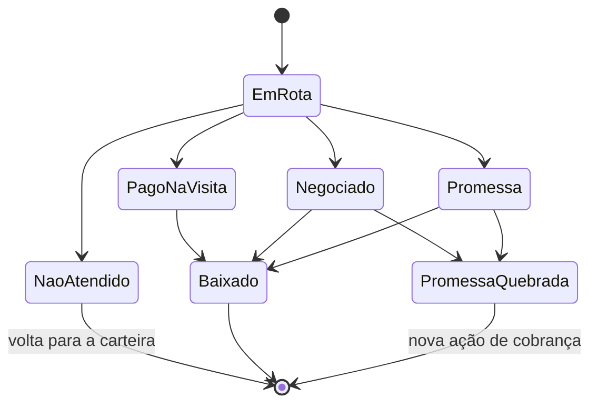

# Regras de negócio e status dos títulos

Cada título segue um ciclo de status único, do momento em que entra numa rota até a baixa ou o encerramento.

## Regras sugeridas

1. Faixas de atraso não podem se sobrepor; um título pertence a uma única faixa por dia.
2. Um cliente com vários títulos vira **um ponto** no mapa, com os títulos agrupados (quantidade e valor somados).
3. Um título já em rota aberta não entra em outra rota no mesmo dia.
4. Check-in só é aceito com GPS próximo ao endereço do cliente (raio configurável, ex.: 200 m); fora do raio, exige justificativa.
5. Negociação ou promessa exige data prometida; sem data, o check-in não fecha.
6. A rota só é encerrada com check-in de finalização; clientes não visitados voltam para a carteira.
7. Títulos com promessa ficam monitorados até a data prometida + tolerância (ex.: 2 dias úteis).

## Status do título

| Status | Quando acontece | Próximo passo |
| --- | --- | --- |
| Em rota | Título incluído em rota enviada ao motoqueiro | Visita |
| Não atendido | Cliente ausente ou recusou atender | Volta para a carteira / nova rota |
| Pago na visita | Cliente pagou no ato | Conferir baixa no ERP |
| Negociado | Novo acordo (parcelamento, novo vencimento) | Monitorar pagamento |
| Promessa de pagamento | Cliente prometeu pagar em uma data | Monitorar até a data |
| Baixado | Pagamento confirmado no ERP | Encerrado |
| Promessa quebrada | Data prometida + tolerância passou sem baixa | Nova ação de cobrança |

## Motivos pré-cadastrados (exemplos para iniciar)

- Pagou no ato
- Prometeu pagar
- Negociou parcelamento
- Cliente ausente / estabelecimento fechado
- Recusou pagar
- Contesta o débito
- Endereço não localizado
- Dificuldade financeira
