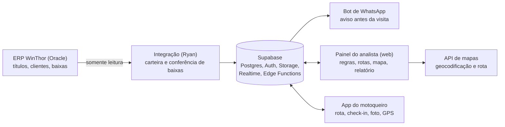

# Arquitetura

Tudo passa pelo Supabase. O ERP só é lido, nunca alterado; a forma de leitura é responsabilidade do Ryan (ver [integração](06-integracao-erp.md)). Para o restante do sistema, a integração é uma caixa que entrega dados nas tabelas `clientes_cache`, `titulos_cache` e atualiza as baixas.



## Camadas

| Camada | Sugestão | Por quê |
| --- | --- | --- |
| Painel web | React (Vite ou Next.js) + Leaflet/Mapbox GL | Mapa interativo com pontos, hover e trilha do motoqueiro |
| App do motoqueiro | React Native com Expo (ou PWA no início) | GPS em segundo plano, câmera e modo offline |
| Backend | Supabase (Postgres, Auth, Realtime, Storage, Edge Functions) | Banco, login, tempo real e fotos num só lugar |
| Integração ERP | Definida pelo Ryan | Leitura do WinThor e conferência de baixas |
| Mapas | Google Maps Platform ou Mapbox | Geocodificação e otimização da ordem de visitas |

## Tempo real

- `checkins` e `rastreamento` são publicados pelo Supabase Realtime.
- O painel assina esses canais filtrando pela rota aberta; não há polling.
- O app envia a posição a cada 30–60 s apenas enquanto a rota está em andamento.

## Segurança

- Supabase Auth com dois perfis: `analista` e `cobrador`.
- RLS: o cobrador só lê e grava as paradas e check-ins das suas rotas; o analista lê tudo da empresa.
- Fotos no Storage em bucket privado, acessadas por URL assinada.
- Rastreamento só durante a rota, com consentimento do motoqueiro (LGPD).

## Estrutura proposta do repositório

```
cobran-a-externa/
├── docs/                 # esta documentação
├── supabase/
│   ├── migrations/       # schema, RLS, views
│   └── functions/        # Edge Functions (ex.: geocodificação, divisão de rota)
├── apps/
│   ├── painel/           # painel web do analista
│   └── motoqueiro/       # app do motoqueiro
└── integracao/           # espaço reservado para a integração do Ryan
```
