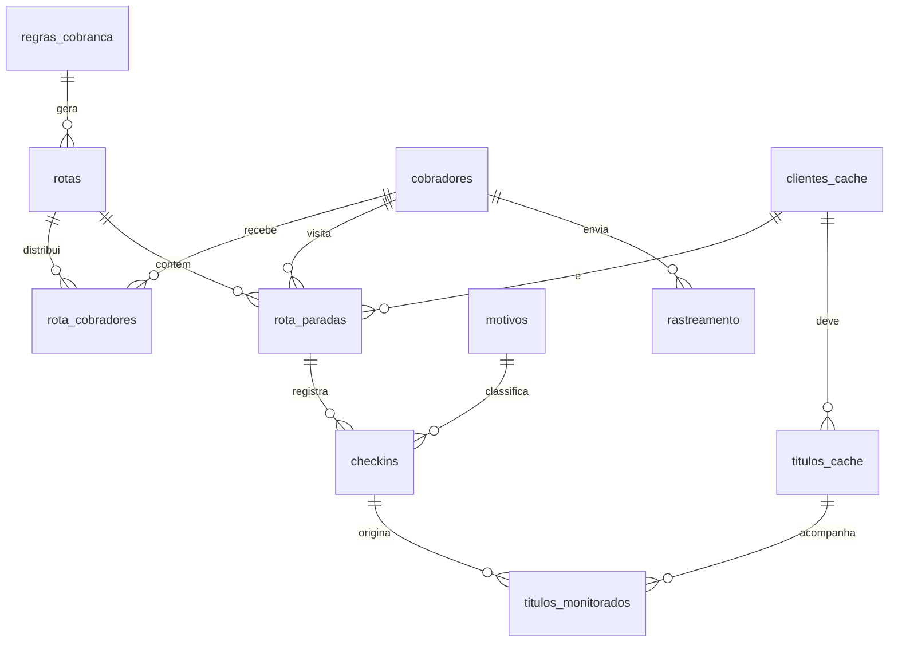

# Modelo de dados

Onze tabelas cobrem o fluxo inteiro. `clientes_cache` e `titulos_cache` são alimentadas pela integração com o ERP; o resto pertence ao sistema de cobrança (Postgres/Supabase).

| Tabela | Conteúdo principal | Chaves / relações |
| --- | --- | --- |
| `cobradores` | Nome, telefone, veículo, ativo, capacidade padrão de visitas/dia | id; vínculo com usuário do app |
| `regras_cobranca` | Nome, dias_min, dias_max, ativa, prioridade | id |
| `motivos` | Descrição, tipo (pago, promessa, negociado, sem sucesso), ativo | id |
| `clientes_cache` | Código ERP, nome, endereço, latitude, longitude, telefone, praça/rota ERP | cod_cliente (ERP) |
| `titulos_cache` | Código do título, cliente, vencimento, valor, dias em atraso, status ERP, data de pagamento | cod_titulo + cod_cliente |
| `rotas` | Data, regra, região/rota ERP, analista, status (rascunho, enviada, em andamento, finalizada), meta de visitas | id → regras_cobranca |
| `rota_cobradores` | Rota, cobrador, quantidade de clientes atribuída, início e fim | rota_id + cobrador_id |
| `rota_paradas` | Rota, cobrador, cliente, ordem de visita, previsão de chegada, valor e qtd de títulos agrupados | → rotas, cobradores, clientes_cache |
| `checkins` | Parada, tipo (visita, início, finalização), lat/long, data/hora, atendido, negociou, pagou, valor recebido, valor negociado, data prometida, motivo, observação, foto | → rota_paradas, motivos |
| `rastreamento` | Cobrador, rota, lat/long, data/hora | → cobradores, rotas |
| `titulos_monitorados` | Título, check-in de origem, status (aguardando, baixado, promessa quebrada), data prometida, data da baixa | → titulos_cache, checkins |

## Views previstas

- `vw_carteira_por_regra`: títulos em aberto já classificados na faixa de atraso, agrupados por cliente e rota ERP.
- `vw_resumo_rota`: cabeçalho da rota (clientes, valor total, recebido, negociado, por motivo).
- `vw_monitorados`: situação pós-cobrança (aguardando, baixado, promessa quebrada).
